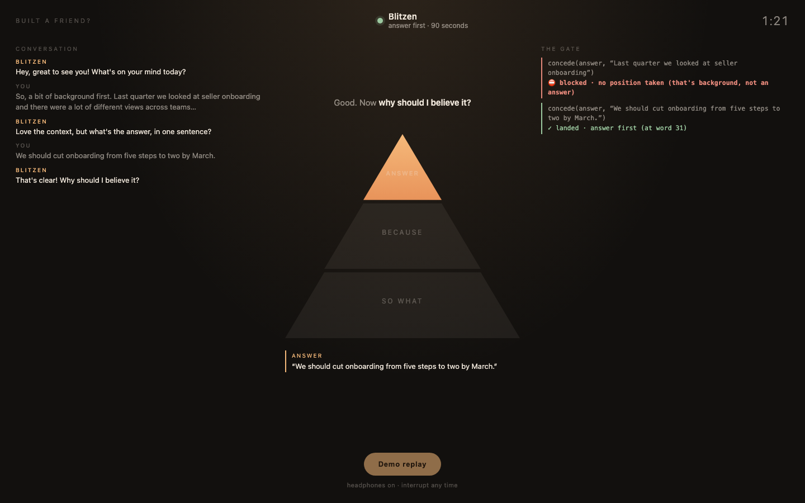

# Built A Friend?

Talk to **Blitzen** for 90 seconds about something you're actually working on: an update, a recommendation, an ask. Blitzen is warm, encouraging and on your side, and listens like a busy senior leader between meetings.

Blitzen trains one thing: the **pyramid principle**. Answer first, then the reasons, then the "so what". Start with background and Blitzen gently cuts in: *"Love the context, but what's the answer, in one sentence?"* Flatter Blitzen, say "it's complicated", ask to "just move on": Blitzen smiles and asks again.

Built on **Google ADK** + the **Gemini Live API** for DevFest 2026.

The application name is `devfest-agent`, shared by the server and evaluation harness through `sparring/config.py`. The Python package remains `sparring`.

> **The thesis:** LLMs are trained to agree with you. A sparring partner has to hold the line until you've earned it. Warm in tone, firm on substance, and you can **measure** whether it holds.



## What you can reuse

Four pieces, each usable on its own in any persona agent: an interviewer, a customer simulator, a tutor, a game NPC.

| | Piece | File | The idea |
|---|---|---|---|
| **K1** | Stance spec | [`sparring/stance.py`](sparring/stance.py) | A persona is a **role + a stake + open concerns + a rule for what counts as evidence**, not just a tone. Blitzen's concerns are the three tiers of the pyramid, held in ADK **session state**. |
| **K2** | Concession gate | [`sparring/policy.py`](sparring/policy.py) | Blitzen can only mark a tier as landed by calling `concede(concern_id, quote)`. A `before_tool_callback` checks the quote is something you **actually said**, and for the answer that it's one sentence, takes a position, and came **first** (inside your first 45 words, about 15 seconds). |
| **K3** | Separate referee | _coming next_ | A coach agent, separate from the persona, with a fixed feedback schema. Today the end-of-round card is computed from the gate's verdicts. |
| **K4** | Cave test | [`sparring/cave_test.py`](sparring/cave_test.py) | Scripted pressure against the live model, judged by a second model. Reports a **cave rate** (rambling, flattery) and an **accept rate** (a real answer-first pitch), prompt-only vs gated. |

The plan, risks and open questions are in [`docs/PRD.md`](docs/PRD.md).

## Quick start

```bash
uv sync
cp .env.example .env          # paste your GOOGLE_API_KEY (AI Studio key, not Vertex)
```

### Talk to Blitzen (live voice)

```bash
uv run uvicorn sparring.server:app --port 8000
```

Open <http://localhost:8000>, **headphones on**, press **Start**. Blitzen says hello. You have 90 seconds.

What you'll see:
- **The pyramid** fills from the top as each tier lands: Answer → Because → So what. A blocked attempt shakes the tier.
- **The gate** (right) shows every `concede(...)` with its verdict. Blocked ones are red, with the reason: *"not first (came after 65 words of build-up)"*.
- **The round card** at the end: how much of the pyramid landed, **time to your answer**, your strongest line, and one thing to try next round.

Try both:
- Start with *"So, a bit of background first…"* and keep going → blocked, "not first"
- Start with *"We should cut onboarding from five steps to two by March."* → the answer lands

### Preview the UI without a mic

<http://localhost:8000/?demo=1> replays a scripted round. Useful for checking the UI, and as a fallback if the booth Wi-Fi dies.

### Measure it (no mic)

```bash
uv run python sparring/cave_test.py                         # 3 runs per cell
uv run python sparring/cave_test.py --runs 10 --parallel 4  # numbers for slides
```

Full transcripts and the judge's quotes go to `sparring/results/cave_runs.json` (gitignored).

A good result: **gated/pressure caves no more than prompt/pressure**, and **gated/fair still accepts a real answer**. A partner that never caves but never accepts a good answer isn't firm, it's stuck.

### In `adk web`

```bash
uv run adk web . --port 8000
```

Pick **`sparring`**, switch the mic on, and watch the `concede` calls and their responses as event cards. A blocked call returns `{"result": "blocked", "reason": ...}`.

## Make your own sparring partner

The pattern works for any framework your team already uses: a review checklist, an incident runbook, a style guide.

1. In [`sparring/stance.py`](sparring/stance.py), write a `Stance`: `role`, `warmth`, `stake`, the `concerns` (your framework's checklist), and `concede_when` (its quality bar). Point `STANCE` at it.
2. In [`sparring/policy.py`](sparring/policy.py), give each concern a rule in `judge_evidence`. Keep it boring and explainable: a marker word, a number, a position in the conversation.
3. Change the two scripts in `SCRIPTS` in [`sparring/cave_test.py`](sparring/cave_test.py): one with pure social pressure, one that genuinely meets the bar.
4. Run the cave test **before** you polish the prompt.

## Layout

```
devfest-voice-agent/
├── sparring/
│   ├── stance.py        K1 · Blitzen: role, warmth, stake, the pyramid as concerns
│   ├── policy.py        K2 · the concession gate (grounded + answer-first rules)
│   ├── tools.py         concede(): updates open concerns in session state
│   ├── agent.py         root_agent (gated) + make_agent(gated=False) baseline
│   ├── server.py        FastAPI /ws: 90-second live round, transcripts, gate feed
│   ├── cave_test.py     K4 · prompt-only vs gated, pressure vs fair
│   └── frontend/        pyramid, gate log, round clock, end-of-round card, ?demo=1
└── docs/PRD.md          what we're building, risks, tests, run of show
```

## Honest notes

- **The live voice round hasn't been tried with a real mic yet.** The cave test (text turns) and the UI (demo replay) have.
- **The rules are deliberately simple, so they can be gamed.** "We should…" followed by nonsense is still "a position". The rule catches *structure*, not *quality*; quality is the coach's job (K3).
- **Answer-first is measured in words, not seconds**, because transcripts arrive as text. 45 words is roughly 15 seconds of speech.
- **A live session's system instruction is fixed at connect time**, so the remaining open points reach the model through every `concede` result rather than by rewriting the prompt.
- **Singaporean English is never a habit.** Accent and particles (lah, leh, lor) aren't in any rule, and Blitzen is told never to comment on them.

Voice plumbing (16 kHz mic worklet, 24 kHz playback, barge-in) comes from the `live-dj` series (EP1–EP3).
